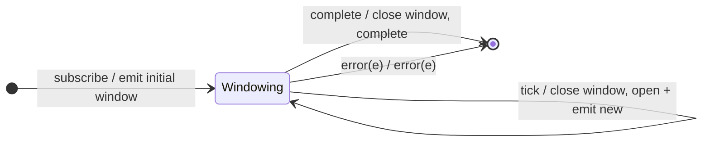

# `windowTime` as a Mealy Machine

> `windowTime(span)` has the same time-boundary logic as
> [`bufferTime`](bufferTime.md), but emits **nested Observables** instead of
> arrays: each window is a live `Subject` that receives the values and is closed
> on the tick.

Signature:

```ts
windowTime<T>(windowTimeSpan: number, ...rest)
```

---

## 1. The 6-Tuple  M = (Q, Σ, Λ, δ, λ, q₀)

### Q — States

- `Windowing(current)` — the currently open window Subject.
- `Done` — terminal.

### Σ — Input alphabet

- `next(v)`, `complete`, `error(e)`, plus `tick` (the `span` timer fires).

### Λ — Output alphabet

- `emit(Observable)` (a new window), plus `innerNext`/`innerComplete` on each
  window Subject; `complete`, `error(e)`.

### δ, λ

A new window Observable is emitted at subscription and after each tick. Each
`next(v)` is forwarded into the current window's Subject. A `tick` closes the
current window and opens a new one.

### q₀ — Initial state

`q₀ = Windowing(W0)` (an initial open window emitted immediately).

---

## 2. State Transition Table (STT)

| # | State             | Input      | Next / Output                                      |
|---|-------------------|------------|----------------------------------------------------|
| 1 | `Windowing(W)`    | `next(v)`  | `W.next(v)`; `noop` (to outer)                     |
| 2 | `Windowing(W)`    | `tick`     | `W.complete()`; open `W'`; `emit(W')`              |
| 3 | `Windowing(W)`    | `complete` | `W.complete()`; `Done`; `complete`                 |
| 4 | `Windowing(W)`    | `error(e)` | `W.error(e)`; `Done`; `error(e)`                   |

Same boundary logic as `bufferTime`; the difference is Λ emits Observables.

---

## 3. State Transition Diagram (STD)



---

## 4. From STT rows to test cases

- **Rows 1-3** — each window observable (flattened with `toArray`) carries the
  values of its `span`-ms slice.

See [`tests/64b-windowTime.test.ts`](../../tests/64b-windowTime.test.ts).

---

## Relationship to the family

`windowTime` is the Observable-valued dual of [`bufferTime`](bufferTime.md)
(array-valued) — the buffer→array / window→Observable duality. See
[`14-time-family.md`](../14-time-family.md).
