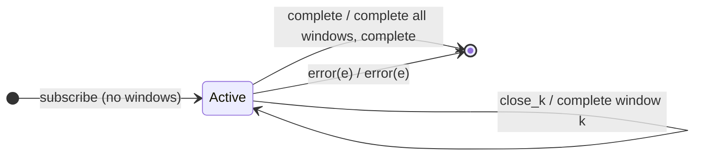

# `windowToggle` as a Mealy Machine

> `windowToggle(openings, closingSelector)` is the Observable-valued twin of
> [`bufferToggle`](bufferToggle.md): each `openings` signal starts a new window
> closed by its own `closingSelector` observable, and **multiple windows can be
> open at once**. It emits **nested Observables** instead of arrays.

Signature:

```ts
windowToggle<T, O>(openings: ObservableInput<O>, closingSelector: (value: O) => ObservableInput<any>)
```

---

## 1. The 6-Tuple  M = (Q, Σ, Λ, δ, λ, q₀)

### Q — States

- `Active(windows)` — a set of currently-open window Subjects, each with its
  closing subscription.
- `Done` — terminal.

### Σ — Input alphabet

- `next(v)`, `complete`, `error(e)`, plus `open(o)` and `close_k`.

### Λ — Output alphabet

- `emit(Observable)` (a new window) plus inner `next`/`complete`; `complete`,
  `error(e)`.

### δ, λ

An `open(o)` creates and emits a new window Subject and subscribes its closing. A
`next(v)` is forwarded into **every** open window. A `close_k` completes window k.

### q₀ — Initial state

`q₀ = Active(∅)`.

---

## 2. State Transition Table (STT)

| # | State       | Input      | Next / Output                                      |
|---|-------------|------------|----------------------------------------------------|
| 1 | `Active(W)` | `open(o)`  | create window `w`; `emit(w)`; subscribe its closing |
| 2 | `Active(W)` | `next(v)`  | `w.next(v)` for **every** open window; `noop`      |
| 3 | `Active(W)` | `close_k`  | `w_k.complete()`; remove k                         |
| 4 | `Active(W)` | `complete` | complete all open windows; `Done`; `complete`      |
| 5 | `Active(W)` | `error(e)` | `Done`; `error(e)`                                 |

---

## 3. State Transition Diagram (STD)



---

## 4. From STT rows to test cases

- **Rows 1-3** — same toggling as `bufferToggle`; each flattened window carries
  its slice's values.

See [`tests/70b-windowToggle.test.ts`](../../tests/70b-windowToggle.test.ts).

---

## Relationship to the family

`windowToggle` is the Observable-valued twin of
[`bufferToggle`](bufferToggle.md). See
[`15-buffering-windowing-family.md`](../15-buffering-windowing-family.md).
