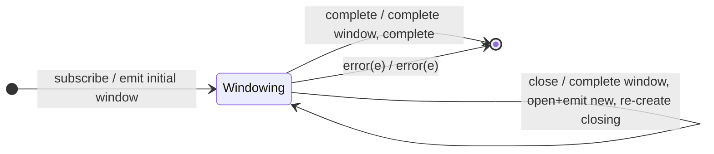

# `windowWhen` as a Mealy Machine

> `windowWhen(closingSelector)` is the Observable-valued twin of
> [`bufferWhen`](bufferWhen.md): a **fresh closing Observable** per window
> controls when the current window closes, but it emits **nested Observables**
> instead of arrays.

Signature:

```ts
windowWhen<T>(closingSelector: () => ObservableInput<any>)
```

---

## 1. The 6-Tuple  M = (Q, Σ, Λ, δ, λ, q₀)

### Q — States

- `Windowing(win, closing)` — current window Subject plus its closing
  subscription.
- `Done` — terminal.

### Σ — Input alphabet

- `next(v)`, `complete`, `error(e)`, plus `close` (the current closing inner
  fires).

### Λ — Output alphabet

- `emit(Observable)` plus inner `next`/`complete`; `complete`, `error(e)`.

### δ, λ

Each `next(v)` is forwarded into the current window. A `close` completes the
window, opens a new one (emitting it), and re-creates the closing observable.

### q₀ — Initial state

`q₀ = Windowing(W0, closingSelector())`.

---

## 2. State Transition Table (STT)

| # | State               | Input      | Next / Output                                           |
|---|---------------------|------------|---------------------------------------------------------|
| 1 | `Windowing(W, c)`   | `next(v)`  | `W.next(v)`; `noop`                                     |
| 2 | `Windowing(W, c)`   | `close`    | `W.complete()`; open `W'`; `emit(W')`; new `closingSelector()` |
| 3 | `Windowing(W, c)`   | `complete` | `W.complete()`; `Done`; `complete`                      |
| 4 | `Windowing(W, c)`   | `error(e)` | `W.error(e)`; `Done`; `error(e)`                        |

---

## 3. State Transition Diagram (STD)



---

## 4. From STT rows to test cases

- **Rows 1-3** — windows close per the closing selector (one value per window,
  mirroring `bufferWhen`).

See [`tests/69b-windowWhen.test.ts`](../../tests/69b-windowWhen.test.ts).

---

## Relationship to the family

`windowWhen` is the Observable-valued twin of [`bufferWhen`](bufferWhen.md). See
[`15-buffering-windowing-family.md`](../15-buffering-windowing-family.md).
