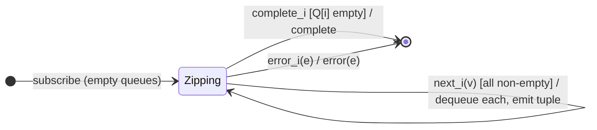

# `zip` as a Mealy Machine

> `zip([...sources])` emits the i-th combined tuple only when **every** source
> has produced its i-th value — pairing strictly **by index**. State is one FIFO
> queue per source; a tuple emits (dequeuing one from each) when all queues are
> non-empty. A fast source buffers ahead while waiting for a slow one.

Signature:

```ts
zip<T extends readonly ObservableInput<unknown>[]>(sources: [...T])
```

---

## 1. The 6-Tuple  M = (Q, Σ, Λ, δ, λ, q₀)

### Q — States

- `Zipping(Q[0..N-1])` — one FIFO queue per source.
- `Done` — terminal.

### Σ — Input alphabet (N sources)

- `next_i(v)`, `complete_i`, `error_i(e)`.

### Λ — Output alphabet

- `emit(tuple)`, `complete`, `error(e)`, `noop`.

### δ, λ

Each value is enqueued on its source's queue. When all queues are non-empty, one
value is dequeued from each and emitted as a tuple. When a source completes with
its queue empty, no further tuples are possible, so zip completes.

### q₀ — Initial state

`q₀ = Zipping([[], …])`.

---

## 2. State Transition Table (STT)

| # | State        | Input        | Guard                           | Next / Output                              |
|---|--------------|--------------|---------------------------------|--------------------------------------------|
| 1 | `Zipping(Q)` | `next_i(v)`  | some other queue empty          | enqueue `v` into `Q[i]`; `noop`            |
| 2 | `Zipping(Q)` | `next_i(v)`  | all queues non-empty after push | dequeue one from each; `emit([...])`       |
| 3 | `Zipping(Q)` | `complete_i` | `Q[i]` empty                    | `Done`; `complete`                         |
| 4 | `Zipping(Q)` | `complete_i` | `Q[i]` non-empty                | stay; may still emit pending tuples        |
| 5 | any          | `error_i(e)` | —                               | `Done`; `error(e)`                         |

Row 3 is the key terminator: a drained source completing ends the zip.

---

## 3. State Transition Diagram (STD)



---

## 4. From STT rows to test cases

- **Row 2** — pairs by index; the faster source buffers ahead.
- **Row 3** — completes when a source drains (no more pairs possible).
- **Row 5** — error terminates the zip.

See [`tests/56a-zip.test.ts`](../../tests/56a-zip.test.ts).

---

## Relationship to the family

`zip` is the per-source-queue strategy; [`zipWith`](zipWith.md) is its pipeable
form and [`zipAll`](zipAll.md) its higher-order form. Contrast with
[`combineLatest`](combineLatest.md), which pairs by *recency* rather than index.
See [`13-combination-family.md`](../13-combination-family.md).
