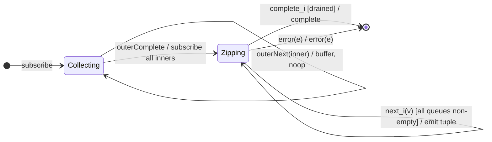

# `zipAll` as a Mealy Machine

> `zipAll()` flattens a **higher-order** source: it buffers all inner
> Observables until the outer completes, then applies [`zip`](zip.md) (index
> pairing) to the collected list. It is the per-queue analogue of
> [`combineLatestAll`](combineLatestAll.md) — a **two-phase** machine.

Signature:

```ts
zipAll<R>()
```

---

## 1. The 6-Tuple  M = (Q, Σ, Λ, δ, λ, q₀)

### Q — States

- `Collecting(inners[])` — Phase 1: buffering inner Observables.
- `Zipping(…)` — Phase 2: the per-source-queue machine of [`zip`](zip.md) over
  the collected inners.
- `Done` — terminal.

### Σ — Input alphabet

- Outer: `outerNext(inner)`, `outerComplete`, `outerError(e)`.
- Inner (Phase 2): `next_i(v)`, `complete_i`, `error_i(e)`.

### Λ — Output alphabet

- `emit(tuple)`, `complete`, `error(e)`, `noop`.

### δ, λ

Phase 1 buffers each inner (`noop`). On `outerComplete`, subscribe all collected
inners and behave exactly like `zip`.

### q₀ — Initial state

`q₀ = Collecting([])`.

---

## 2. State Transition Table (STT)

| # | State           | Input              | Next / Output                        |
|---|-----------------|--------------------|--------------------------------------|
| 1 | `Collecting(I)` | `outerNext(inner)` | `Collecting(I ++ [inner])`; `noop`   |
| 2 | `Collecting(I)` | `outerComplete`    | `Zipping(zip(I))`; `noop`            |
| 3 | `Zipping(…)`    | inner notifications| as per [`zip`](zip.md)               |
| 4 | any             | `error(e)`         | `Done`; `error(e)`                   |

---

## 3. State Transition Diagram (STD)



---

## 4. From STT rows to test cases

- **Rows 1-3** — inner observables are zipped by index only after the outer
  completes.

See [`tests/59c-zipAll.test.ts`](../../tests/59c-zipAll.test.ts).

---

## Relationship to the family

`zipAll` is the higher-order form of [`zip`](zip.md), the per-queue analogue of
[`combineLatestAll`](combineLatestAll.md). See
[`13-combination-family.md`](../13-combination-family.md).
